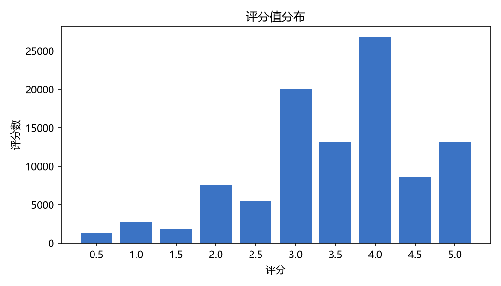
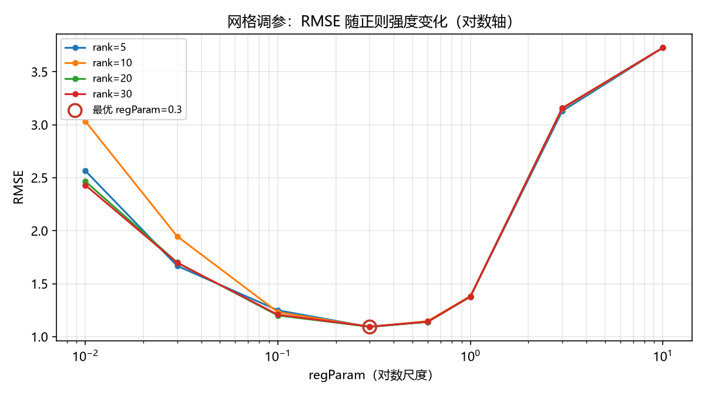
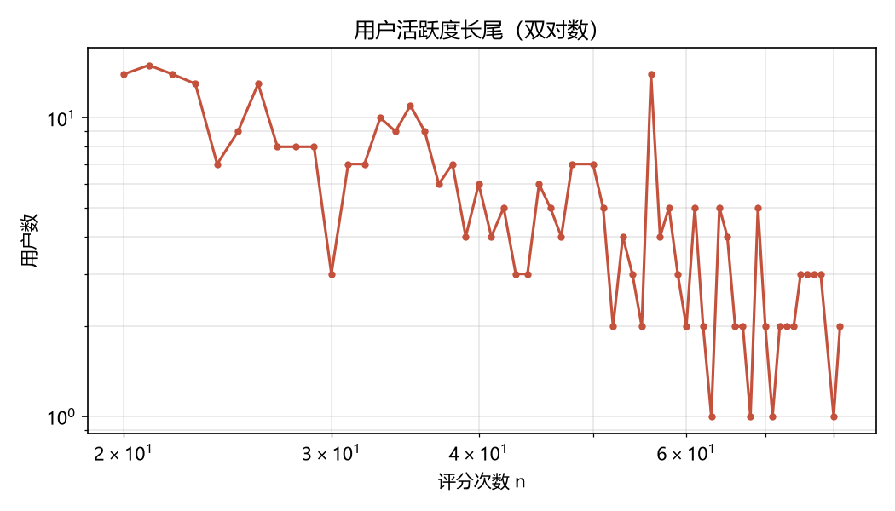

# 基于 Hadoop / Spark 的 MovieLens 电影推荐系统

> 2026 秋《大数据处理》课程大作业 · 独立完成 · 基于 Spark MLlib ALS 协同过滤
> 数据：`ml-latest-small`（100,836 条评分 / 610 用户 / 9,742 部电影）
> 架构：HDFS 三节点分布式存储 + Spark SQL / MLlib + Hive 离线统计 + Streamlit 交互演示



---

## 1. 项目简介

### 背景

推荐系统要解决的问题是**信息过载**：电影数量远多于单个用户能浏览的范围，而用户-电影评分矩阵又极其稀疏（本项目 610 × 9742 的矩阵里只有约 10 万条已知评分，填充率不到 2%）。协同过滤不从影片内容出发，而是利用「口味相近的用户过去喜欢什么」来补全这个稀疏矩阵。ALS（交替最小二乘）把评分矩阵近似分解为用户隐向量矩阵 `U` 与物品隐向量矩阵 `V`：

```
R ≈ U · Vᵀ        (rank = 隐向量维度)
```

这一分解天然适合用 Spark 分布式计算实现，也是课程参考方向之一。

### 目标

1. 搭起一条完整的**大数据处理流水线**：数据入湖 → 清洗 → 统计分析 → 建模 → 评估 → 导出 → 可视化，而不是只跑一个算法。
2. 用 RMSE / MAE 与「全局均值基线」对照，量化 ALS 是否真的学到了偏好。
3. 用网格调参定位正则强度的 U 型曲线谷底，并做健康检查防止模型退化为常数预测。
4. 为**全部 610 个用户**生成 Top10 推荐、为**每一部有隐向量的电影**生成 Top10 相似影片，保证结果可查询、可演示。
5. 如实记录课程集群的资源约束与工程取舍，不虚构分布式训练。

### 交付范围

| 范围 | 说明 |
|---|---|
| 数据集 | 只使用 `ml-latest-small`，不使用 `ml-32m` 全量 |
| 计算模式 | HDFS 三节点分布式**存储** + 同一 master 容器内 Spark `local[2]` **计算** |
| 必做主链 | 环境自检 / 清洗 / EDA / ALS 训练与评估 / 结果导出 / 画图 / 演示 |
| 拓展模块 | 32 组网格调参、隐向量余弦相似电影（全量）、Hive 外部表统计、Streamlit 交互页 |
| 未包含 | 冷启动策略、时间切分、实时流、跨节点分布式训练（均为主动裁剪，非遗漏） |

---

## 2. 系统架构与技术选型

```
┌─ Windows 宿主 ─────────────────────────────────────────────┐
│  plot/make_figures.py   画图（pandas + matplotlib）         │
│  app/streamlit_app.py   交互演示页（只读 CSV，不连集群）     │
└──────────────────────────┬─────────────────────────────────┘
                           │ scp 取回 CSV
┌─ Ubuntu 24.04 虚拟机（VMware，NAT，2 核 / 4–6GB）─────────┐
│  download_data.sh / submit.sh / install_numpy.sh            │
│  ┌──────── Docker 容器：master / worker1 / worker2 ──────┐ │
│  │  HDFS 3.3.6   NameNode + 2 DataNode，dfs.replication=2 │ │
│  │  Spark 3.5.5  local[2]（master 容器内单机 2 线程）      │ │
│  │  Hive 4.0.1   外部表指向 HDFS 原始 CSV，beeline 查询    │ │
│  └────────────────────────────────────────────────────────┘ │
└────────────────────────────────────────────────────────────┘
```

| 层 | 组件 / 版本 | 作用 |
|---|---|---|
| 虚拟化 | VMware Workstation + Ubuntu Server 24.04.5 LTS | 课程实验一搭建的 Linux 环境 |
| 容器 | Docker 29.8.1 | 三节点集群（复用实验二~四，不重搭） |
| 分布式存储 | Hadoop HDFS 3.3.6，`hdfs://master:9000` | 原始 CSV、Parquet、模型、结果统一入湖 |
| 计算 | Spark 3.5.5 + PySpark，`local[2]` | Spark SQL 清洗统计、MLlib ALS 建模 |
| 数据仓库 | Hive 4.0.1 + MySQL 8.0.43 metastore | 外部表与离线统计查询 |
| 可视化 | pandas + matplotlib / Streamlit | 7 张统计图 + 三页签交互演示 |

### 为什么计算层是 `local[2]`（重要，报告中如实说明）

课程实验四的 Standalone 集群有 3 个 Worker，**每个只有 1 核 + 512 MiB**。Spark 3.5 硬性要求 `spark.executor.memory ≥ 450 MiB`（实测报 `INVALID_EXECUTOR_MEMORY: must be at least 471859200`），而 450 MiB 加上 `memoryOverhead` 必然超过 512 MiB：调大则 `Initial job has not accepted any resources` 无限排队，调小则直接报错。

因此在**课程默认配置**下 Standalone 模式无法为 PySpark 分配 executor。本项目改用同一 master 容器内的 `local[2]`：**不申请 executor**，HDFS 照读、Spark SQL / MLlib API 与执行计划不变，只是不跨节点并行。调大课程 `SPARK_WORKER_MEMORY` 可恢复分布式，但虚拟机只有 4–6GB，性价比很低。

> 数据入湖与元数据管理仍基于 Hadoop 三节点；这是一条有实测依据的工程取舍，不是简化掉大数据架构。详见 [docs/ENVIRONMENT.md](docs/ENVIRONMENT.md)。

---

## 3. 功能模块

| 脚本 | 输入 | 输出 | 说明 |
|---|---|---|---|
| `src/00_check_env.py` | HDFS 原始 CSV | 控制台 | 检查 PySpark 版本、运行模式、数据可读性 |
| `src/01_preprocess.py` | `ratings.csv` / `movies.csv` | `clean/*`（Parquet） | 显式 Schema、值域过滤、去重、派生日期列、8:2 划分（seed=42） |
| `src/02_eda.py` | `clean/*` | `eda/*`（6 组 CSV） | 评分分布、用户/电影长尾、热门 Top20、类型分布、年份趋势 |
| `src/03_train_als.py` | `clean/train`、`clean/test` | `model/als_baseline`、`out/top10` | ALS 基线（rank=20, maxIter=10, regParam=0.1）+ RMSE/MAE + 全局均值对照 + **610 用户全量 Top10** |
| `src/04_tune.py` | `clean/train`、`clean/test` | `eda/tune`、`model/als_best` | **32 组**网格（rank 4 档 × regParam 8 档，对数尺度）、边界检查、预测分布健康检查 |
| `src/06_similarity.py` | `model/als_best`、`clean/movies` | `out/similar_all`、`out/similar` | 隐向量归一化后分块矩阵乘法，**每部电影 Top10 相似**；另存单部案例供 PPT |
| `src/07_export.py` | `out/*`、`eda/tune` | `export/*_csv` | Parquet → 文本 CSV，便于 `hdfs dfs -getmerge` 取回 |
| `sql/hive_ddl.sql` | HDFS 原始 CSV | Hive 外部表 | 建表 + 规模概览 / 评分分布 / 活跃用户三条统计 |
| `plot/make_figures.py` | `results/*.csv` | `results/figures/*.png` | 7 张图，调参图用对数 x 轴并圈出谷底 |
| `app/streamlit_app.py` | `results/*.csv` | 网页 | 个性化推荐 / 相似电影 / 热门电影 三页签 |

辅助脚本：`submit.sh`（统一 spark-submit 封装）、`download_data.sh`（下载数据集）、`install_numpy.sh`（离线补依赖）、`check_deps.py`（容器内依赖自检）。

---

## 4. 目录结构

```
.
├── README.md                  ← 本文件
├── LICENSE                    MIT
├── requirements.txt           Windows 侧画图/演示依赖
├── .gitignore                 大文件、数据集、临时产物不入库存
├── .gitattributes             强制 *.sh 使用 LF（避免 Windows 换行坑）
├── src/                       7 个 PySpark 作业脚本（按编号顺序执行）
├── sql/hive_ddl.sql           Hive 外部表与统计
├── plot/make_figures.py       本机画图
├── app/streamlit_app.py       Streamlit 演示页
├── scripts/
│   ├── fetch_wheels.py        有网机器上下载离线 wheel
│   └── make_bundle.sh         一键重建 bundle.tgz
├── docs/
│   ├── ENVIRONMENT.md         环境约束与离线依赖说明
│   ├── DATASET.md             数据来源、许可与引用
│   └── PUSH_TO_GITHUB.md      完整上传步骤与报错处理
├── wheels/README.md           离线 wheel 说明（wheel 本体不入库）
├── results/                   本次实验输出：CSV + 7 张 PNG
│   └── README.md              数据字典（每个文件的来源与列名）
└── figures 见 results/figures/
```

**不纳入版本管理的文件**（由 `.gitignore` 排除，可随时重建）：

| 文件 | 大小 | 获取方式 |
|---|---|---|
| `bundle.tgz` | ~53 MB | 在仓库根目录运行 `bash scripts/make_bundle.sh` |
| `wheels/*.whl` | ~55 MB | 在有网机器运行 `python scripts/fetch_wheels.py` |
| `data/ml-latest-small*` | ~1 MB | 运行 `bash download_data.sh`（GroupLens 数据不允许再分发） |
| HDFS 上的 `model/`、`clean/` | — | 由 `01` / `03` / `04` 脚本训练生成，seed 固定可复现 |

---

## 5. 快速复现

> 前置：已按课程实验一~四搭好 VMware + Ubuntu + Docker 三节点集群；集群用 `cd ~/lab04 && bash start-spark.sh` 启动。
> 命令前的 `[Windows]` / `[VM]` 表示执行位置，不要敲混。

### 5.1 准备（一次性）

```powershell
# [Windows] 本机画图与演示依赖
python -m pip install -r requirements.txt
```

```bash
# [VM] 把本仓库放到 ~/bigdata-final（可用 scp / 共享文件夹 / git clone）
cd ~/bigdata-final
bash download_data.sh                 # 下载 ml-latest-small 到 data/
python scripts/fetch_wheels.py        # 有网时补齐 wheels/*.whl
bash install_numpy.sh                 # 离线装入 master 容器：numpy + distutils 兼容层
```

容器里的 `/opt/final/` 不是数据卷，**每次重建容器后**都要重做：

```bash
docker exec master mkdir -p /opt/final
docker cp ~/bigdata-final/src/. master:/opt/final/
```

### 5.2 数据入湖

```bash
# [VM]
docker exec master hdfs dfs -mkdir -p /user/root/movielens/ratings /user/root/movielens/movies
docker cp ~/bigdata-final/data/ml-latest-small/ratings.csv master:/tmp/ratings.csv
docker cp ~/bigdata-final/data/ml-latest-small/movies.csv  master:/tmp/movies.csv
docker exec master hdfs dfs -put -f /tmp/ratings.csv /user/root/movielens/ratings/
docker exec master hdfs dfs -put -f /tmp/movies.csv  /user/root/movielens/movies/
bash submit.sh 00_check_env.py
```

### 5.3 主流程（按编号执行）

```bash
# [VM] 顺序不可颠倒：04 会覆盖 model/als_best，06 读的正是它
bash submit.sh 01_preprocess.py
bash submit.sh 02_eda.py
bash submit.sh 03_train_als.py
bash submit.sh 04_tune.py
bash submit.sh 06_similarity.py
bash submit.sh 07_export.py
```

常用覆盖参数：`DRIVER_MEM=2g PARTITIONS=8`、`GRID_RANKS=... GRID_REGS=...`、`TARGET_MOVIE=1`、`REC_USER_LIMIT=0`。完整变量表见手册附录 C。

### 5.4 Hive 统计（可与 Spark 分阶段执行，别同时开，虚拟机内存有限）

```bash
# [VM]
docker exec hive /usr/local/hive/bin/beeline \
  -u 'jdbc:hive2://localhost:10000/default' -f /opt/final/hive_ddl.sql
```

### 5.5 取回结果、画图、演示

```bash
# [VM] 取回 9 个 CSV，打包成 export.tgz
docker exec master bash -lc 'rm -f /tmp/*.csv'
for n in dist user_longtail movie_longtail popular genres by_year; do
  docker exec master hdfs dfs -getmerge /user/root/movielens/eda/$n /tmp/$n.csv
done
for n in recs similar similar_all tune; do
  docker exec master hdfs dfs -getmerge /user/root/movielens/export/${n}_csv /tmp/$n.csv
done
docker exec master bash -lc 'cd /tmp && tar czf export.tgz *.csv'
docker cp master:/tmp/export.tgz ~/bigdata-final/results/
```

```powershell
# [Windows]
cd results
scp bigdata@<虚拟机IP>:~/bigdata-final/results/export.tgz .
tar -xzf export.tgz
cd ..
python plot\make_figures.py
python -m streamlit run app\streamlit_app.py   # 浏览器打开 http://localhost:8501
```

---

## 6. 实验与结果

### 6.1 实验设置

| 项 | 值 |
|---|---|
| 数据集 | `ml-latest-small`，100,836 条评分 / 610 用户 / 9,742 部电影 |
| 清洗 | 显式 Schema 转类型、评分限制 `[0.5, 5.0]`、按 `(userId, movieId, ts)` 去重；实测无异常行被剔除 |
| 划分 | 8:2 随机划分，`seed=42` |
| 基线 ALS | `rank=20, maxIter=10, regParam=0.1, coldStartStrategy="drop"` |
| 网格 | `rank ∈ {5,10,20,30}` × `regParam ∈ {0.01,0.03,0.1,0.3,0.6,1.0,3.0,10.0}` = **32 组**，`maxIter=10` |
| 调参策略 | 20% 子样本上 `TrainValidationSplit(0.8)` 搜索，最优组合在完整训练集重训一次 |
| 评估 | RMSE / MAE，并与「预测恒等于训练集均值」的基线对照 |
| 计算资源 | `local[2]`，driver 1g，`spark.sql.shuffle.partitions=4` |

### 6.2 主要结果

| 产物 | 规模 | 位置 |
|---|---|---|
| 全量个性化推荐 | **6,100 行 / 610 用户** × Top10 | `results/recs.csv` |
| 全量相似电影 | **89,540 行 / 8,954 部电影** × Top10 | `results/similar_all.csv` |
| 调参记录 | 32 行 | `results/tune.csv` |
| 统计图 | 7 张 PNG | `results/figures/` |

**调参的 U 型曲线**：最初只在 `regParam ∈ [0.01, 0.3]` 搜索时观察到「正则越大 RMSE 越小」的单调下降——最优点落在范围外。把上界按对数尺度外推到 10 后，曲线出现完整谷底：

| regParam（rank=5） | 0.01 | 0.1 | **0.3** | 0.6 | 3.0 | 10.0 |
|---|---|---|---|---|---|---|
| 子样本 RMSE | 2.5656 | 1.2490 | **1.0917** | 1.1397 | 3.1291 | 3.7268 |

全网格最低点为 `rank=5, regParam=0.3, RMSE≈1.0917`，位于网格内部，说明谷底已被覆盖。`04_tune.py` 还会检查预测标准差与全局均值基线，防止强正则把模型压成常数预测。





### 6.3 已知局限

- 只使用 10 万条评分的小样本验证全流程，未做大规模数据压力测试。
- 计算层为单机 `local[2]`，未利用跨节点并行（原因见第 2 节）。
- 只有训练集中被评过分的电影才有隐向量（9,742 部中约 8,954 部可查相似结果）；冷门影片评分稀疏，相似质量较低。
- ALS 本身不处理新用户/新物品冷启动，本方案主动裁剪了该模块。

---

## 7. 数据集与许可

- 数据集：**MovieLens ml-latest-small**，由 GroupLens Research 提供，官方下载地址 <https://grouplens.org/datasets/movielens/latest/>。
- 按 GroupLens 使用条款，数据集**不随本仓库分发**，请运行 `bash download_data.sh` 自行下载；在报告/论文中使用需按 [docs/DATASET.md](docs/DATASET.md) 引用。
- 代码：MIT License（见 [LICENSE](LICENSE)）。
- 第三方离线 wheel（numpy / setuptools）版权归各自项目所有，仅用于无外网容器补依赖，不随仓库分发。

---

## 8. PPT「相关资源」页可直接使用的内容

```
源代码：https://github.com/<你的GitHub用户名>/movielens-recommender
数据集：https://grouplens.org/datasets/movielens/latest/  （ml-latest-small，100,836 条评分）
实验结果：仓库 results/ 目录（9 个 CSV + 7 张 PNG）
模型权重：ALS 模型保存在课程集群 HDFS 的 /user/root/movielens/model/als_best，
          由 04_tune.py 以 seed=42 训练生成，可用仓库脚本一键复现，未提交二进制。
实施手册：docs/ENVIRONMENT.md（环境约束）与 docs/PUSH_TO_GITHUB.md（仓库说明）
```

把 `<你的GitHub用户名>` 换成实际用户名即可。

---

## 9. 常见问题

| 现象 | 处理 |
|---|---|
| `set -o pipefail: invalid option name` | `.sh` 被 Windows 转成 CRLF。虚拟机里 `sed -i 's/\r$//' *.sh`；本仓库 `.gitattributes` 已强制 LF |
| `No module named 'numpy'` / `'distutils'` | 重跑 `bash install_numpy.sh`；每次重建容器都要重跑 |
| `Initial job has not accepted any resources` | 用了集群模式。确认 `submit.sh` 打印 `master=local[2]` |
| `cd: /opt/final: No such file or directory` | 重新 `docker exec master mkdir -p /opt/final && docker cp ~/bigdata-final/src/. master:/opt/final/` |
| 所有 Web UI 打不开 | Windows 浏览器要用 `http://<虚拟机IP>:8080`，不是 `localhost`；不影响流水线，可跳过 |
| 修改 `04_tune.py` 后相似结果对不上 | 必须按 `04 → 06 → 07` 顺序重跑，`06` 读的是 `model/als_best` |

---

## 10. 作者与致谢

- 独立完成：环境搭建、数据处理、建模评估、可视化与报告（课程大作业，一人小组）。
- 集群环境基于课程实验一~四提供的 VMware / Docker / Hadoop / Spark / Hive 镜像与脚本。
- 数据由 GroupLens Research 提供；ALS 实现来自 Apache Spark MLlib。
